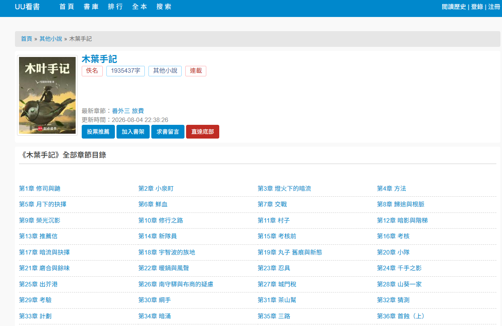
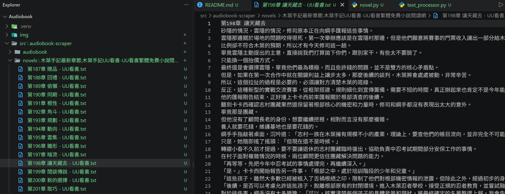

# UU小說網爬蟲


# 安裝步驟

## 1. 安裝套件
```
uv sync
```

## 2. 啟動虛擬環境
```
.venv\Scripts\Activate.ps1
```

## 3. 啟動
```
cd src\audiobook-scraper
```
```
 uv run scrapy crawl novel -a start_url="小說全章節目錄url"
```


# 成果
